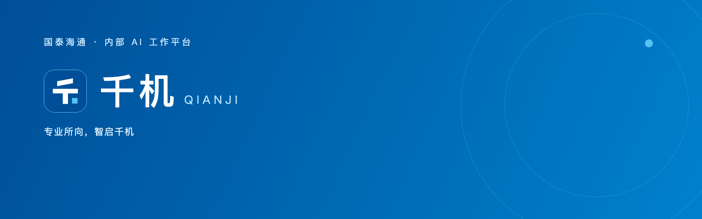

<p align="center">
  
</p>

# 千机 · Qianji

面向国泰海通内部使用的 AI 工作平台，提供对话、助手、文件处理、数据分析与任务协作。

- 中文显示名：**千机**
- 英文项目名：**qianji**
- 工作区包名：**@qianji/\***
- 品牌主色：**#004E97**，辅助蓝 **#0081CC**，亮蓝 **#54C3F1**，取自[国泰海通官网](https://www.gtht.com/)及其官方标识。

## 本地运行 WebUI

需要 Node.js 22–24、Bun，以及 QianjiCore 后端。后端从仓库内的产品源码快照构建：`node scripts/prepareQianjicore.js`。仓库内已有 `resources/bundled-qianjicore/<平台-架构>/qianjicore` 时可以直接使用。

```bash
bun install
bun run webui
```

默认访问 **http://127.0.0.1:25809/**。首次登录账号和密码由启动终端输出；升级时继续使用已有账号。

```bash
# 使用现有构建启动
bun run webui --no-build

# 指定端口和数据目录
QIANJI_PORT=25809 QIANJI_DATA_DIR=/path/to/data bun run webui

# 构建前端与桌面进程
bun run package

# 启动桌面开发模式
bun run dev
```

默认 WebUI 数据目录为 `~/.qianji-web-dev`。检测到旧目录时，通过目录别名复用原有数据，保留账号、会话和设置。

## 工作场景

工作台提供研究材料梳理、业务文稿起草、表格与数据分析、会议纪要整理四类入口。选择场景后会填入草稿，由用户补充材料并发送给当前选定的助手和模型。

保留现有的助手管理、模型配置、文件工作区、定时任务和团队协作能力。模型服务需要按实际环境配置；企业单点登录、统一权限及内网模型网关尚未接入。

## 项目结构

| 目录                      | 内容                               |
| ------------------------- | ---------------------------------- |
| `packages/desktop`        | Electron 主进程、IPC 与 React 界面 |
| `packages/web-host`       | WebUI 静态服务与后端代理           |
| `packages/web-cli`        | `qianji-web` 命令                  |
| `packages/shared-scripts` | 共享构建脚本                       |
| `public`                  | PWA 与浏览器升级脚本               |
| `tests`                   | 单元、集成与端到端测试             |

内部模块、组件、命令、深链接、环境变量与缓存前缀使用 Qianji / qianji / QIANJI 命名。千机后端、引擎编号、环境变量和数据协议已统一命名，不提供旧名称兼容。详细边界和定制入口见[内部产品说明](docs/contributing/internal-product.md)。`docs/readme/` 保留多语言功能参考，内部部署以本文和内部产品说明为准。

## 开发检查

```bash
bun run lint
bun run format:check
bunx tsc --noEmit
bun run i18n:types
node scripts/check-i18n.js
bun run test
```

贡献规范见 [CONTRIBUTING.md](CONTRIBUTING.md)。

## 开源来源

本产品包含开源软件，遵循相应许可证并保留作者版权，详见[来源与许可证](packages/web-host/assets/SOURCES.md)。
